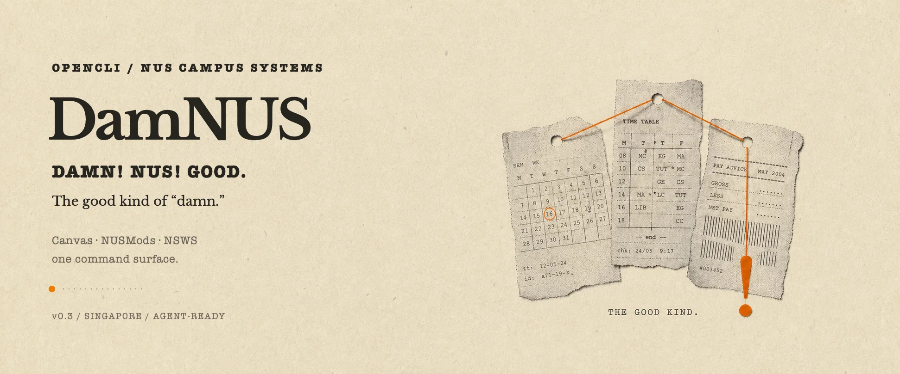

<p align="center">
  
</p>

<p align="center">
  <strong>Less tab-hopping. More getting things done.</strong><br>
  <code>v0.3.0</code> · <code>Node ≥ 21</code> · <code>MIT</code>
</p>

## Start here

You need [OpenCLI](https://github.com/jackwener/opencli), this plugin, and—for logged-in NUS systems—the OpenCLI Chrome extension.

```bash
# 1. Install OpenCLI
npm install -g @jackwener/opencli

# 2. Install DamNUS
opencli plugin install github:KehaoC/DamNUS

# 3. Check the browser bridge
opencli doctor
```

Install the [OpenCLI Chrome extension](https://chromewebstore.google.com/detail/opencli/ildkmabpimmkaediidaifkhjpohdnifk), then sign in to [NUS Canvas](https://canvas.nus.edu.sg/) and/or [NSWS](https://inetapps.nus.edu.sg/nsws/app/student/dashboard) in Chrome. NUSMods needs no login.

<details>
<summary><strong>Develop locally</strong></summary>

```bash
git clone https://github.com/KehaoC/DamNUS.git
cd DamNUS
opencli plugin install "file://$(pwd)"
```

Local installs are symlinked, so edits are available immediately.

</details>

## The good stuff

| System | What DamNUS does | Start with |
| --- | --- | --- |
| **Canvas** | Courses, details, announcements, files, downloads | `opencli canvas courses` |
| **NUSMods** | Module discovery, requirements, timetables | `opencli nusmods search "machine learning"` |
| **NSWS** | Search and filter TA/RA jobs | `opencli nsws jobs --role ta` |

```bash
# Catch up on Canvas, find a file, download it
opencli canvas announcements --limit 20 -f table
opencli canvas files BMS5502S --query project -f table
opencli canvas download 9626985 --output ./downloads -f json

# Check a module and its classes
opencli nusmods module CS1010S --acadYear 2026-2027 -f json
opencli nusmods timetable CS1010S --semester 1 --day Tue -f table

# Find campus work worth applying for
opencli nsws jobs --role ta --minRate 20 -f table
```

## Command map

<details open>
<summary><strong>Canvas</strong></summary>

```text
opencli canvas courses [--includeNonAcademic] [--limit N]
opencli canvas course <course-id-or-code>
opencli canvas announcements [course-id-or-code] [--limit N]
opencli canvas files <course-id-or-code> [--query TEXT] [--limit N]
opencli canvas download <file-id-or-url> [--output DIR]
```

Canvas reuses your Chrome session in memory. Downloads create the destination directory and never overwrite an existing file.

</details>

<details>
<summary><strong>NUSMods</strong></summary>

```text
opencli nusmods search <query> [--acadYear YYYY-YYYY] [--semester 0-4]
opencli nusmods module <module-code> [--acadYear YYYY-YYYY]
opencli nusmods timetable <module-code> [--semester 1-4] [filters]
```

The academic year defaults to the current NUS July–June cycle. Timetables can be filtered by lesson type, class number, and weekday.

</details>

<details>
<summary><strong>NSWS jobs</strong></summary>

```text
opencli nsws jobs [--role ta|ra|ta,ra|all] [--query TEXT]
                  [--applicant TYPE] [--payment TYPE]
                  [--minRate SGD] [--limit N]
```

TA and RA roles are included by default. DamNUS searches and compares jobs; it never submits an application for you.

</details>

## Agent-ready Skills

```bash
mkdir -p ~/.codex/skills
ln -s "$(pwd)/skill/damnus" ~/.codex/skills/damnus
ln -s "$(pwd)/skill/damnus-nusmods" ~/.codex/skills/damnus-nusmods
ln -s "$(pwd)/skill/damnus-nsws-jobs" ~/.codex/skills/damnus-nsws-jobs
ln -s "$(pwd)/skill/damnus-search" ~/.codex/skills/damnus-search
```

- `$damnus` routes NUS requests to the right workflow.
- `$damnus-nusmods` handles module and timetable research.
- `$damnus-nsws-jobs` finds and recommends TA/RA opportunities.
- `$damnus-search` performs sourced Xiaohongshu research and verifies original-note links.

Canvas stays CLI-only until its Skill scenarios are worth encoding. EduRec is not supported yet.

## Trust, then verify

DamNUS never stores browser credentials. Canvas and NSWS authentication stays in the live Chrome session; NUSMods uses public data. To run the complete test and adapter checks:

```bash
npm test
opencli validate canvas/courses
opencli validate canvas/announcements
opencli validate canvas/download
opencli validate nusmods/search
opencli validate nsws/jobs
```

Adapter decisions: [Canvas](docs/canvas-strategy.md) · [NUSMods](docs/nusmods-strategy.md) · [NSWS](docs/nsws-strategy.md)

---

<p align="center">
  <strong>Damn! NUS! Good.</strong><br>
  <sub>Built for NUS students who would rather type one command than open five tabs.</sub>
</p>
